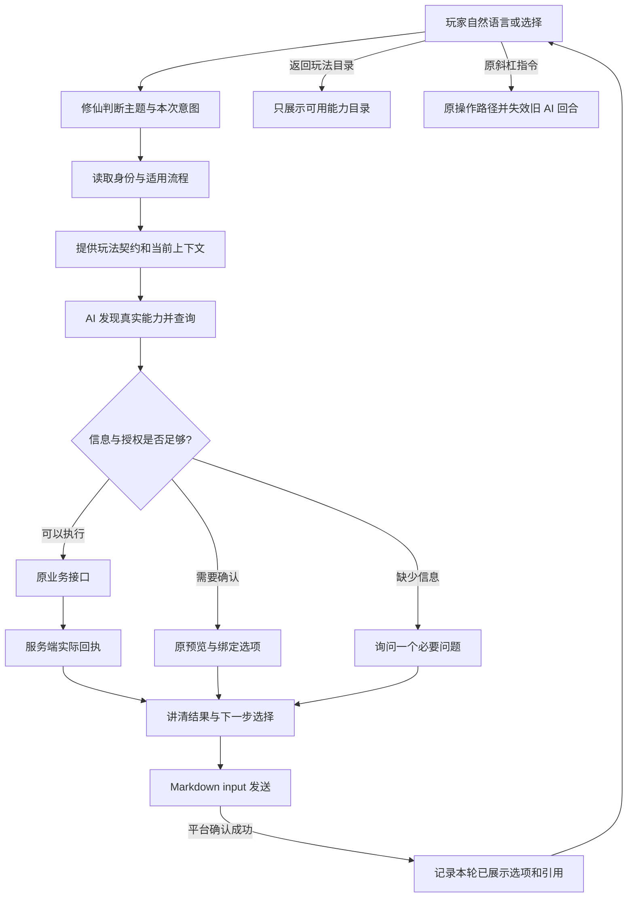

# AI 对话式游玩修仙：本轮落地与验收

目标是让玩家用自然语言持续查看、选择和操作玩法，AI 根据修仙插件的当前契约行动，玩家随时用原 `/` 指令接管。AI 不自行维护角色、库存、价格、奖励或确认凭据。

## 复盘发现及修复

| 原缺口                                      | 本轮实现                                                                      | 验证边界                                     |
| ------------------------------------------- | ----------------------------------------------------------------------------- | -------------------------------------------- |
| 普通玩法只有历史文本，缺少本轮玩法资料      | 新增 `get_play_context`：主题、实际能力目录、原调用参数、结果状态及已投递选项 | 当前插件目录与临时上下文；不是服务端实时状态 |
| 首次询问背包等普通玩法可能回到序章          | 普通玩法请求显式使用 gameplay 状态查询；未注册仍由身份接口判断                | 不跳过服务端原准入和任务规则                 |
| AI 生成的普通选项未进入接续判断             | 成功投递后记录；同轮多个气泡合并，新轮替换                                    | 普通选项不是消费或确认凭据                   |
| 查询原参数丢失，翻页和回看依赖猜测          | 记录最近真实 action、arguments 和结果状态；过大参数省略，不截断当原参数使用   | 模糊对象仍须查验或澄清，不猜 ID              |
| 普通查询被宿主视为一次性 write 而复用旧结果 | 将现有 observation 的处理函数声明绑定到实际导出动作名，发布 fresh 策略        | 真正写入不按名字误判为只读，原幂等规则保留   |
| 大型插件的策略超过宿主 128 条限制           | 通用桥按已注册动作数校验，并保留 4096 上限和重复/类型校验                     | 宿主不包含修仙动作名单                       |
| 超过 20 个自然语言选项退成原标记文字        | Markdown input 展示和投递登记上限统一为 100                                   | 超出范围仍需插件分页，不承诺无限长平台消息   |
| 普通游玩缺少稳定退出和换玩法入口            | 提供“返回玩法目录”“退出AI游玩”；目录由真实注册能力生成                        | 目录不意味着角色已经解锁，也不执行任何业务   |

## AI 如何知道怎么玩

插件提供两层资料：

1. `get_conversation_contract` 提供介绍、注册、剧情、查询、预览、确认和消费的规则，以及原确认动作关系。
2. `get_play_context` 提供本轮主题相关的能力索引和上下文。能力描述、effect 和必填参数名从实际 Expose 注册获取，完整 schema 继续由工具发现获得。索引最多展开 40 项，并明确总数；普通查询优先展示，不隐藏其余动作。

主题包括背包装备、炼丹、锻造、修行境界、探索战斗、功法神魂、宗门、道侣同道、洞府灵田、商店交易、任务日常、资料排行。未归入这些主题的已注册能力保留“其他玩法”入口。这是能力导航，不是每一种玩法都已完成真实账号实测的声明。

每一轮先核对真实身份和适用状态，再读取玩法数据。普通玩法不会仅因存在新手教学而自动返回教学；玩家明确选择继续教学时才回到相应状态。问“怎么玩”仍是介绍，不自动注册或消费。

## 连续游玩流程

## 展示示意

以下是交互样式，物品、页数和结算内容必须来自实际响应：

> 大肥鱼：先看看你带着什么。想看道具、材料还是装备？
>
> [查看道具] [查看材料] [查看装备]
>
> 玩家：查看材料
>
> 大肥鱼：这一页的材料已经查到了。
>
> （展示实际材料与数量）
>
> [再看一些] [返回玩法目录] [退出AI游玩]

炼丹、锻造等有确认流程的玩法仍需展示原预览，等待对应完整选择，再提交原服务端凭据。泛指“确认”或模型自行补写的确认不能替代原绑定选择。对话式体验不意味着取消确认保护。

## 无 AI 与异常

无 AgentLink 时原流程照常；AI 关闭时原注册、引导和玩法入口保留。模型错误不能解释为业务未执行，必须区分工具实际结果与模型表达失败。会话超过 30 分钟、重启或原引用失效时重新核对，不偷偷创建新预览提交。自动恢复不会重复消费。

当前仍不提供跨进程持久对话、不承诺任意自然语言都能正确理解，也没有代替真实 QQ 平台投递验证。程序测试中的模拟模型只证明调用流程，真实模型与真实平台须分别验收。

## 回归入口

- `yarn test:agent-play`：原确认/引导保护和新增完整多轮玩法测试，包含真实宿主发送拆泡、选项登记、连续翻页、返回目录、手动接管。
- `node tools/run-framework-tests.mjs --filter=conversation-play-context`：真实插件注册表、静态目录、查询策略、身份状态与消息归属。
- `node tools/run-framework-tests.mjs --filter=guidance-flow`：原注册、介绍和教学兼容。
- AgentLink 的执行策略与回复展示测试：大型插件声明、真实写入防重、35 项实际 Markdown input。
- AgentLink 的 `game-guidance-integration.test.mjs`：隔离 Go 夹具；真实模型为显式启用的独立验证项。

本轮不修改数据库、游戏数值或存档结构。宿主与插件需配套更新，避免旧宿主拒绝新增的大型查询策略。

## 本地验收记录（2026-11-02）

- 游玩回归 132 项、玩法上下文 11 项、原引导兼容 10 项、宿主相关回归 64 项全部通过。
- 真实修仙插件 + AgentLink + 隔离 Go 服务集成通过，覆盖手动/AI 进度衔接及已提交结果保留。
- 真实模型验证不稳定：一次真实调用将序章从第 2 步推进到第 3 步，随后模型超时，已执行剧情回执保留；最新一次在首次模型请求即超时，未推进，严格的单步推进断言失败。不能将这项记为稳定通过，也不能据此宣称可以直接上线。
- 通用渲染协议新增可选 `incomplete`，插件可提供自然的未完成提示；旧插件不声明该字段时，宿主不传入它。失败提示不承诺业务未执行，仍保留原操作核对与手动接管入口。
- 未部署，未验证真实 QQ 投递。上线前仍需使用目标模型配置完成连续多轮验收，并在 QQ 核对无前缀按钮、引用确认、原指令接管和模型超时后的实际表现。
