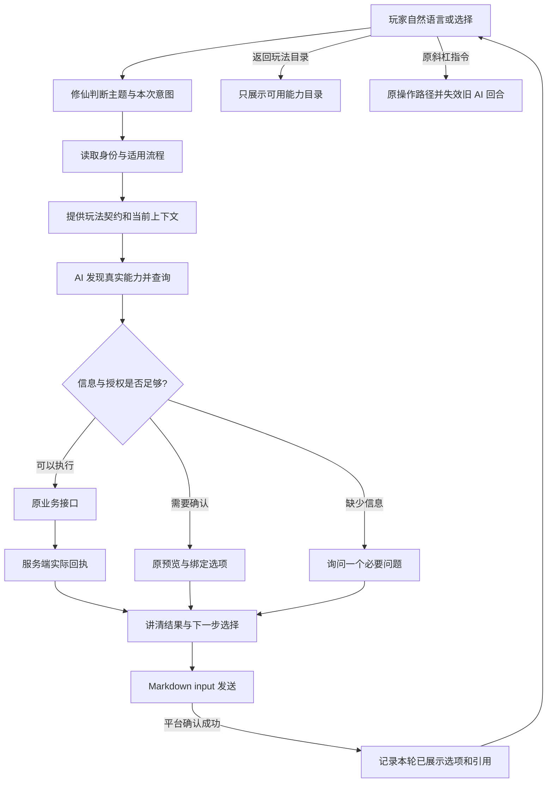

# AI 对话式游玩修仙：本轮落地与验收

2026-11-03 更新：当前可见的离开入口改为“暂离”，旧“退出AI游玩”仅保留历史消息兼容。故障回复使用实际 Markdown input，模型无法回复时目录与暂离仍由插件直接处理。下文旧批次记录中的退出措辞不再作为当前展示规范。升级/晋级/领奖的目标规划与持久化定时采收已进入本地实现和回归阶段；定时执行仍需配套升级框架，尚未完成线上验收。固定文字通知不能替代收割。详见 [本批记录](bubble-style/BATCH-dialogue-recovery.md)。

停用范围补充：通用教学动作也会在请求业务接口前拒绝已下架指令，不能借旧按钮或模型记忆绕过已撤下的专用能力；新建连锁任务步骤同样拒绝已下架指令。只匹配完整指令名称，不按参数中的“黑盒”“主题”等词误拦正常操作；已有任务存档不自动改写。

最新扩大验收：真实模型隔离集成已成功推进一次序章（第 2 步到第 3 步），无额外消费或领奖，原剧情只展示一次，不追加玩家拒绝的跳过选项。单次通过不代表长期模型稳定或 QQ 实机验收完成。完整离线框架回归 7,821 项中 7,805 通过、16 失败，涉及洞府、锻造出口、Expose 注册审计、文档能力目录、分页、宗门权限、入群欢迎、周期商品和宝物概率页，仍需核对，不能宣称全量通过。

本次还修复了大参数与大回执组合挤掉全部历史回执的问题：先限制单条记录，过大时保留动作及省略说明，不截断参数后继续使用，原确认引用不变。对明确只继续剧情的请求，契约要求执行一次已授权推进，展示保留原剧情，不重复改写；明确要求解释或分析剧情时仍保留回应。

后续核对已解决上述失败中的三项审计问题：按协议名定位业务目录、递归展开动作集合，已核对 642 个业务动作、9 个生命周期动作和文档中 70 个常用动作；新增用例确认同名覆盖仍会失败。锻造路由测试改为读取实际声明，验证“切换”“替换”及参数路由，保留原市场筛选语法检查。没有通过放宽断言或修改业务功能掩盖这些问题。其他失败项尚未解决，未重新宣称全量通过。

继续核对发现并修复两个实际问题：业务拒绝原因中的下架名称曾导致整行原因被删除，现保留服务端拒绝事实，同时继续过滤下架按钮；待核对周期订单曾错误隐藏服务端允许的免费剩余权益，现仅在无待核对订单或原订单为服务端 TP 周期订单时，恢复零价且 `canClaimFree` 明确允许的领取入口；TD 每日及未知订单仍先核对原结果，付费购买继续拦截，不自动领取。宗门失败恢复 164 项、下架过滤 12 项、充值展示 12 项均通过，相关服务端原规则测试通过。用户随后明确要求下架玩法同步停用 AI：已撤下宗门大比、黑盒、玩家小店、主题与墨色的 36 个动作（含任务别名、查询、预览和执行），当前业务协议保留 606 个动作，对话生命周期仍为 9 个。旧动作不可发现、不可调用，不请求业务接口；正常市场、商店、设置与任务继续保留。

目标是让玩家用自然语言持续查看、选择和操作玩法，AI 根据修仙插件的当前契约行动，玩家随时用原 `/` 指令接管。AI 不自行维护角色、库存、价格、奖励或确认凭据。

## 复盘发现及修复

| 原缺口                                      | 本轮实现                                                                      | 验证边界                                     |
| ------------------------------------------- | ----------------------------------------------------------------------------- | -------------------------------------------- |
| 普通玩法只有历史文本，缺少本轮玩法资料      | 新增 `get_play_context`：主题、实际能力目录、原调用参数、结果状态及已投递选项 | 当前插件目录与临时上下文；不是服务端实时状态 |
| 首次询问背包等普通玩法可能回到序章          | 普通玩法请求显式使用 gameplay 状态查询；未注册仍由身份接口判断                | 不跳过服务端原准入和任务规则                 |
| AI 生成的普通选项未进入接续判断             | 成功投递后记录；同轮多个气泡合并，新轮替换                                    | 普通选项不是消费或确认凭据                   |
| 查询原参数丢失，翻页和回看依赖猜测          | 记录最近真实 action、arguments 和结果状态；过大参数省略，不截断当原参数使用   | 模糊对象仍须查验或澄清，不猜 ID              |
| 普通查询被宿主视为一次性 write 而复用旧结果 | 将现有 observation 的处理函数声明绑定到实际导出动作名，发布 fresh 策略        | 真正写入不按名字误判为只读，原幂等规则保留   |
| 大型插件的策略超过宿主 128 条限制           | 通用桥按已注册动作数校验，并保留 4096 上限和重复/类型校验                     | 宿主不包含修仙动作名单                       |
| 超过 20 个自然语言选项退成原标记文字        | Markdown input 展示和投递登记上限统一为 100                                   | 超出范围仍需插件分页，不承诺无限长平台消息   |
| 普通游玩缺少稳定退出和换玩法入口            | 提供“返回玩法目录”“退出AI游玩”；目录由真实注册能力生成                        | 目录不意味着角色已经解锁，也不执行任何业务   |

## AI 如何知道怎么玩

插件提供两层资料：

1. `get_conversation_contract` 提供介绍、注册、剧情、查询、预览、确认和消费的规则，以及原确认动作关系。
2. `get_play_context` 提供本轮主题相关的能力索引和上下文。能力描述、effect 和必填参数名从实际 Expose 注册获取，完整 schema 继续由工具发现获得。索引最多展开 40 项，并明确总数；普通查询优先展示，不隐藏其余动作。

主题包括背包装备、炼丹、锻造、修行境界、探索战斗、功法神魂、宗门、道侣同道、洞府灵田、商店交易、任务日常、资料排行。未归入这些主题的已注册能力保留“其他玩法”入口。这是能力导航，不是每一种玩法都已完成真实账号实测的声明。

每一轮先核对真实身份和适用状态，再读取玩法数据。普通玩法不会仅因存在新手教学而自动返回教学；玩家明确选择继续教学时才回到相应状态。问“怎么玩”仍是介绍，不自动注册或消费。

## 连续游玩流程



## 展示示意

以下是交互样式，物品、页数和结算内容必须来自实际响应：

> 大肥鱼：先看看你带着什么。想看道具、材料还是装备？
>
> [查看道具] [查看材料] [查看装备]
>
> 玩家：查看材料
>
> 大肥鱼：这一页的材料已经查到了。
>
> （展示实际材料与数量）
>
> [再看一些] [返回玩法目录] [退出AI游玩]

炼丹、锻造等有确认流程的玩法仍需展示原预览，等待对应完整选择，再提交原服务端凭据。泛指“确认”或模型自行补写的确认不能替代原绑定选择。对话式体验不意味着取消确认保护。

## 无 AI 与异常

无 AgentLink 时原流程照常；AI 关闭时原注册、引导和玩法入口保留。模型错误不能解释为业务未执行，必须区分工具实际结果与模型表达失败。会话超过 30 分钟、重启或原引用失效时重新核对，不偷偷创建新预览提交。自动恢复不会重复消费。

当前仍不提供跨进程持久对话、不承诺任意自然语言都能正确理解，也没有代替真实 QQ 平台投递验证。程序测试中的模拟模型只证明调用流程，真实模型与真实平台须分别验收。

## 回归入口

- `yarn test:agent-play`：原确认/引导保护和新增完整多轮玩法测试，包含真实宿主发送拆泡、选项登记、连续翻页、返回目录、手动接管。
- `node tools/run-framework-tests.mjs --filter=conversation-play-context`：真实插件注册表、静态目录、查询策略、身份状态与消息归属。
- `node tools/run-framework-tests.mjs --filter=guidance-flow`：原注册、介绍和教学兼容。
- AgentLink 的执行策略与回复展示测试：大型插件声明、真实写入防重、35 项实际 Markdown input。
- AgentLink 的 `game-guidance-integration.test.mjs`：隔离 Go 夹具；真实模型为显式启用的独立验证项。

本轮不修改数据库、游戏数值或存档结构。宿主与插件需配套更新，避免旧宿主拒绝新增的大型查询策略。

## 本地验收记录（2026-11-02）

- 游玩回归 132 项、玩法上下文 11 项、原引导兼容 10 项、宿主相关回归 64 项全部通过。
- 真实修仙插件 + AgentLink + 隔离 Go 服务集成通过，覆盖手动/AI 进度衔接及已提交结果保留。
- 真实模型验证不稳定：一次真实调用将序章从第 2 步推进到第 3 步，随后模型超时，已执行剧情回执保留；最新一次在首次模型请求即超时，未推进，严格的单步推进断言失败。不能将这项记为稳定通过，也不能据此宣称可以直接上线。
- 通用渲染协议新增可选 `incomplete`，插件可提供自然的未完成提示；旧插件不声明该字段时，宿主不传入它。失败提示不承诺业务未执行，仍保留原操作核对与手动接管入口。
- 未部署，未验证真实 QQ 投递。上线前仍需使用目标模型配置完成连续多轮验收，并在 QQ 核对无前缀按钮、引用确认、原指令接管和模型超时后的实际表现。

### 模型故障后的本地恢复入口

模型首次请求失败、执行后回复未完成时，均提供“返回玩法目录”和“退出AI游玩”的无前缀按钮。两个入口由插件直接处理，不调用模型、不重放业务操作；重复退出仍返回明确结果。原 `/` 指令继续作为故障退路。回归运行真实宿主处理器和消息发送节点，覆盖模型持续失败时打开目录、退出和再次退出。

### 状态核对失败后的写入保护

本轮调用过身份/流程状态查询但尚未取得有效回执时，插件拒绝普通写入、剧情推进及消费，返回 `GAME_STATE_UNAVAILABLE`。旧会话中的成功身份不能替代本轮核对。只读能力及显式声明的 fresh observation 可继续用于核对；重新取得有效状态后，仍按原授权、预览与确认规则操作。再次查询失败会撤销本轮先前的核对结果。旧插件未提供状态能力时维持原兼容路径，原 `/` 操作不受此对话保护影响。

### 跨玩法接续与总览

当前选择的玩法与上次实际操作分别保存。玩家从背包转向炼丹，即使尚在回答炉数等问题、还没有执行炼丹能力，后续短回答也沿用炼丹资料；历史 action、参数和原确认引用不会被改写。返回目录清除当前玩法选择，保留实际回执和待确认引用，不代表取消原业务。总览问题“修仙怎么玩”不继承旧专题；明确询问“炼丹怎么玩”才返回炼丹介绍。`current.lastActionTopic` 是可选补充字段，用于标明历史操作所属主题，不是实时状态。

## 目标规划资料（2026-11-03）

`get_play_context.planning` 新增插件拥有的目标规划，现有字段保留。规划自动进入 `gameGuidance.prepare` 的模型上下文，不依赖宿主硬编码修仙逻辑。它不读取数据库、不执行业务，也不把目标解释成消费授权。

| 玩家目标         | 查询与分支                                     | 执行边界                                                                                                 |
| ---------------- | ---------------------------------------------- | -------------------------------------------------------------------------------------------------------- |
| 如何快速升级     | 天书与角色、境界缺口、闭关进度与加速费用       | 比较真实收益与成本，不编造最优数值，不自动连续消费                                                       |
| 帮我提升境界     | 实时突破与晋升资格，按回执进入渡劫或新境界目录 | 不把突破与晋级都试一遍，原确认与风险说明保留                                                             |
| 帮我领取奖励     | 按范围查签到、任务、活跃、成就与邮件           | 只领符合条件的奖励，不扩展成付费补签或购买；区分失败与未处理                                             |
| 定时采收灵田灵药 | 本人灵田、成熟状态、时间时区与地块             | 保存预约成功才承诺；固定文字通知不算采收，宿主已有持久化预约、执行及结果通知；仍需配套框架升级与实机验收 |

每一步只列当前已注册的动作，缺失能力放在 `missingActions`，不冒充可调用。`get_tianshu` 是现有服务端设计与开放条件来源；模板没有复制收益公式、成熟时间或成功率。装备、功法、宝物的升级请求不转成角色境界提升。

验证运行真实 Expose 注册、输出 schema、路由和对话准备；覆盖四条路径、部分插件能力缺失、模型上下文注入和不同成长对象。离线验证不代表真实模型已稳定完成整个业务链，也不代表已部署或 QQ 实机验收。

## 模型回答前的目标事实读取（2026-11-03）

目标规划与当前事实分开：规划描述仍由插件提供，新增 `goal-evidence.ts` 在权威引导状态明确为已注册的普通玩法时读取首轮事实，再放入 `gameGuidance.prepare` 的本轮上下文。

- 快速升级：天书、角色、境界、闭关进度。加速费用和其他资源仍按后续实际需要查询，不能凭这组初始数据声称已找到最优方案。
- 提升境界：天书、角色、境界资格与缺口。
- 领取奖励：天书、签到状态、任务面板。领取动作目录补齐一键签到与邮件领取；未查询其他奖励项目不能声称全部领完。
- 定时采收：天书、本人洞府状态；这里仅查询，不签发预约、不提前采收。

只调用本轮明确声明为 read 或由插件显式绑定为 fresh observation 的能力；按实际 effect 分别使用 expose_read、expose_write 或 expose_call，不改写动作声明，也不按 get 前缀放行。缺失能力、失败和资料预算不足均显式告知模型，不将未知解释成无奖励、未注册或满足晋级条件。天书过长时保留原介绍、注意事项及当前/下一阶段，标明完整目录省略；不截断 JSON 或伪造规则。资料不跨轮或跨玩家缓存。

注册、序章和原生教学阶段不走这组自动补查；玩家手动接管后停止旧轮读取。准备阶段的观察面板不登记为玩家新选择，也不自动追加到消息气泡。模型仍须按实际请求区分咨询与执行，不能把查询结果当成消费或风险确认。

`goal-evidence.test.mjs` 使用真实框架 Expose 和对话准备器验证四个目标，以及未注册、序章、教学、读取失败、写能力伪装成查询名、手动接管等分支。它验证事实进入上下文及没有自动业务写入，不代表真实模型已完成全部成长和领奖链路。

### 真实能力声明回归修复

发现旧测试将全部观察动作简化为 read，掩盖了真实目录中的 unknown 查询与 write 观察动作被准备器跳过的问题。现在角色、境界、签到状态、洞府和闭关进度通过 observationQuery 显式绑定实时观察策略；天书和任务面板复用原 observation。原 effect、身份授权、服务端准入和实时读取语义保持不变，不将所有查询改成 read。经过准入的观察仍可能结算服务端常规资源，不能将它描述为数据库绝对无写入。

新增 goal-catalogue.test.mjs 直接注册完整 gameExpose 目录，按实际动作声明校验工具选择，并断言准备资料进入模型上下文、执行动作不被标记为观察。业务返回值为测试夹具，不宣称真实数据库联调。原 goal-evidence.test.mjs 保留拒绝伪装写动作、注册/序章/教学与手动接管分支。

本批类型检查和 lint 通过；目标定向回归 14 项通过，完整 agent-play 回归 198 项中 182 通过、16 项因已安装旧框架缺后台 API 跳过，无失败。后台能力的独立发布包验证记录见宿主 docs/scheduled-actions.md。

### 规划资料完整性验证

天书超过准备资料预算时，仅对 `ok=true`、`success=true`、`branch=business` 的有效回执生成摘要，保留 success、branch、reason、原介绍、注意事项及当前/下一阶段。准入拒绝不能被摘要转换成有效规则；过大且无法保留的资料明确标记未附入，不能据此断言已核对状态。保留原回执对象，不为摘要修改它。

每次观察返回后再次检查取消信号，包括最后一次观察；手动接管期间返回的迟到资料不得继续进入模型。新增预算测试覆盖有效摘要、拒绝回执、超大资料与最后一步取消。

本批目标回归 18 项通过。`node tools/run-framework-tests.mjs --filter=expose-tianshu` 的 3 项测试通过，使用 Go `TestRobotBusinessBooksPublicAndAdmission` 真实路由产生的夹具，经真实插件 Expose 处理器进入 goalEvidence，核对原介绍、注意事项、当前/下一境界与业务状态，且仅调用一次天书观察。该验证使用隔离服务端夹具与模拟 HTTP 传输，不是线上模型或 QQ 实机验收。类型检查与 lint 通过。

### 真实模型单步验证与宿主策略兼容

2026-11-03 再次运行 AgentLink 的显式启用真实模型测试，游戏连接隔离 Go 服务、平台发送使用测试回执。首次序章未推进，模型收到 `EXECUTION_POLICY_UNAVAILABLE`：宿主策略解析器仅允许 effect=write，插件新增 unknown 的显式实时观察声明导致整份策略被拒绝。

宿主现允许已注册 unknown 动作声明 fresh，仍拒绝不存在的动作、read 动作误声明、重复项及 unknown 的 operation 声明；fresh 不改变原动作 effect，也不免除提供方授权。混合目录测试覆盖 unknown 观察重复读取和真正 write 只执行一次，通用策略回归 9 项通过。

修正后使用当前配置的真实模型复验：序章从第 2 步准确推进到第 3 步，保留原剧情和无斜杠继续入口，角色快照不变，没有无关签到、消费或领奖。单次真实模型测试通过，不代表连续多轮稳定性或 QQ 实机验收。

升级顺序：先更新包含 unknown/fresh 兼容的 AgentLink，再更新发布这些观察策略的修仙插件。旧宿主会拒绝整份新策略，不能只发插件。后台定时能力还须单独升级包含 createBackgroundRunner 的框架。

同批 `expose-cultivation-contract` 的 2 项服务端契约测试通过：真实 Go 境界多状态回执经插件及 goalEvidence 保留原材料、资格、修为和成功率；异常数值仍明确拒绝。测试拦截所有境界请求，断言仅 GET 身份与境界查询，不调用突破或晋级接口。类型检查通过。

后续确定性多步集成仍失败：`real game plugin + Link + Go services preserve manual/AI progress and committed results` 连续请求四段序章后，原剧情回执里泄漏斜杠入口，并出现超长正文分段及未完成提示；当前首先失败于旧的剧情/模型说明顺序断言。未删除或放宽该断言，根因与后续断言尚待排查。不能以单步真实模型通过宣称完整手动/对话衔接已通过。

### 手动玩法接入对话与连续剧情修复

上述多步失败现已定位：初始消息“带我继续修行”不匹配“带我修行”的路由；手动注册后尚无对话会话，模型调用工具才迟到接入，缺少本轮状态和对话展示上下文。插件路由及旧协议识别现支持“带我继续修行”“带我接着修行”，仍不接管斜杠消息或翻译等无关请求，不以路由匹配授予执行权限。

集成测试拆成两个独立隔离场景：四轮独立玩家选择，以及玩家明确请求连续四段剧情。两者均使用真实 AgentLink、修仙插件与 Go 测试服务，模型输出为固定工具调用夹具；验证剧情原文只出现一次、按原顺序到达教学、每轮保留输入入口、不显示斜杠继续/签到、原生教学接管、战斗后模型失败仍保留已推进版本、旧按钮不重复执行。旧测试要求展示 `/继续引导` 与固定模型套话，已改为当前无斜杠和原剧情完整性要求，没有删除后续业务进度断言。

两个多步集成场景均通过；框架路由与上下文测试 19 项通过；完整 agent-play 共 202 项，186 通过、16 项旧框架后台能力跳过、0 失败。类型检查、lint 通过。此结果取代上段“待排查”的状态，但不替代真实模型连续多轮或 QQ 实机验证。

### 连续选择与真实引气晋级验证

2026-11-03 的两轮真实模型测试曾发现：玩家发送已展示的“继续”，模型没有调用插件便编写新剧情，服务端仍停在原步骤。处理分为两层：插件只对上一轮已送达的精确“继续”、实时序章第 2/3 步以及唯一对应的原继续能力执行一次原动作；本轮后续模型写操作被拒绝，观察仍走原准入。引气晋级、第 5 步领奖和任意自由文本不走这一自动推进分支。没有实际剧情回执时，展示当前插件状态和可选入口，不把模型编造的故事当成推进结果。

最新真实模型集成连续完成三轮：第 2 → 3 步、第 3 → 4 步、第 4 → 5 步。第三轮使用模型调用原晋级能力，隔离 Go 服务确认角色从凡人进入炼气一层（realmId 1 → 2），修为归零，灵石和灵晶均未变化，尚未领取第 5 步完成奖励。每轮真实发送节点都有无斜杠 Markdown input，未泄漏选择标记或“退出AI”字样。第二轮准备晋级的修为变化按原境界配置核对，而不是假设所有叙事步骤均不改变数据。

验证使用当前配置的真实模型、真实宿主和插件、隔离 Go 测试服务及测试平台回执；不是线上账号或 QQ 实机验证。对应宿主测试为 `test/game-guidance-integration.test.mjs`，需显式启用 GUIDANCE_LIVE_MODEL=1。测试通过一次只证明该次连续执行，不能宣称模型稳定性或全部成长、领奖、定时链路完成。

本批完整 agent-play 202 项：186 通过、16 项旧框架缺后台 API 跳过、0 失败；类型检查、lint 及差异空白检查通过。宿主新增第三轮测试通过语法检查和真实模型运行。后台框架配套发布、四项目标端到端与真实平台投递仍是未完成验收项。

### 序章领奖到签到教学的衔接修复

继续扩展真实模型测试发现两个实际缺口：已领取入门奖励后仍显示“继续／跳过序章”；明确点击第 5 步“继续”时模型有时仅输出文本，没有执行领奖。现精确选择处理覆盖原序章第 2～5 步：必须是上一轮已送达的“继续”、当前实时状态仍提供唯一原继续能力；执行一次后拒绝模型再次写入。晋级与领奖仍调用原服务端流程，原校验与幂等保留，不把自由聊天解释成继续。

每次序章继续或跳过得到有效业务回执或原中间件 guide 回执后重新读取引导状态。进入 onboarding 时通过既有 get_onboarding 观察读取本轮教学动作，不自动执行该动作。修复不能只判断 branch=business：原序章由中间件处理，这正是第一次刷新未生效的原因。

本段取代上段“第 4/5 步不走精确选择分支”的实现描述。宿主真实模型测试现覆盖四轮到入门领奖：角色进入炼气一层，灵晶按原奖励增加 200，灵石不变，最终按钮为无斜杠“签到”，服务端仍处于 checkin 教学。测试直接核对真实 Markdown 节点与隔离 Go 服务状态，使用测试平台发送回执，未连接真实 QQ。普通分轮和明确批量推进也新增最终签到入口与无过期跳过入口断言。

展示对照图位于仓库外 `/Users/lemonade/Documents/bubble-style-mockups/prologue-onboarding-handoff.svg.png`，为示意图，不是平台截图。修复只在修仙插件与跨项目集成测试内，未增加 AgentLink 的修仙业务代码。

分轮夹具进一步发现旧会话普通玩法模式会将序章完成后的刷新路由到 free_play。现在仅在收到实际序章操作回执后，以 guidance 模式刷新当前原生引导；普通玩法查询不强制改模式。分轮集成保留模型重复请求继续的场景，确认精确选择执行后重复写入被阻止。

### 教学签到与查看主线的对话执行

真实模型第 5 轮点击“签到”曾被 playTopic 分类为普通领奖，模型因此选择普通签到能力，被服务端当前教学拦截。现已送达且属于 guidance 会话的精确按钮选择保持引导模式；读取到 onboarding 后补查真实 get_onboarding 回执，并向模型提供 perform_onboarding_action 的完整运行时契约及原 version/command。不会在准备阶段自动签到或战斗；milestone-handoff 仍交回原玩法。

修复后真实模型六轮集成通过：序章推进、晋级、领取原入门资源、签到、查看主线 1。签到后的教学阶段为 chapter，按钮 data 精确为“查看主线 1”；下一轮查看后进入 explore，显示服务端原“主线挑战 1-1”入口，角色资源快照保持不变，没有自动战斗或额外领奖。测试对照真实隔离 Go 服务状态和 Markdown input 节点，不以模型说“成功”作为结果依据。

本批完整 agent-play 202 项中 186 通过、16 项因旧框架后台 API 缺失跳过；类型检查、lint 与差异空白检查通过。展示示意图：`/Users/lemonade/Documents/bubble-style-mockups/onboarding-checkin-routing.svg.png`。未发布，未验证真实 QQ；完整成长规划、一般性奖励领取及定时采收端到端验收仍未完成。

### 明确教学按钮的原版本执行

重复真实模型验证说明：此前六轮成功不足以证明稳定性。模型仍可能把“签到”当咨询，要求重复确认；观察其他玩法又可能改写会话模式。现在记录成功送达的教学选项快照（原 version、phase、command），精确匹配下一条玩家输入后，由插件按原版本调用一次 perform_onboarding_action，再让模型解释。后台观察得到的新版本不会替换已经送达的按钮版本；milestone-handoff 不走教学执行。普通文字、未送达选项、不唯一匹配都不会在该分支自动执行。

模型重复写入被本轮选择锁拦截。已匹配的教学选项优先于普通玩法话题分类，不会因模型观察改了会话模式而失去教学路由。有真实操作回执的精确选择直接保留回执和最新输入，避免模型复述引入重复面板或“可选指令”文案。

新增测试验证：成功发送后才登记原版本；未发送的新查询不能升级旧按钮；手动签到推进后点击旧签到入口，服务端明确拒绝原旧版本，角色快照和教学版本不变。分轮与批量 Go 集成均通过；完整 agent-play 203 项中 187 通过、16 项旧框架后台 API 缺失跳过。类型检查、lint 通过。展示示意图位于 `/Users/lemonade/Documents/bubble-style-mockups/lesson-choice-execution.svg.png`。

七轮测试超过宿主默认每分钟 6 次限制，隔离测试配置单独设为 30，生产配置不变。业务客户端使用独立连接池，全局 fetch 拦截不能证明实际请求次数；隔离 Go fixture 增加仅含 operation/command 的接收记录，既不记录鉴权头，也不修改业务路由、数据库结构或结算。战斗请求次数由服务端记录核验。

最终真实模型七轮复验通过：服务端仅收到一次 onboarding.action 的 `/主线挑战 1-1` 请求，教学版本推进到 4，原结算回执为胜利、3 星、修为 +25、灵石 +10、精力 -10，保留“主线挑战 1-2／领取宝箱 1”两个无斜杠入口。该证据来自隔离 Go 服务与测试平台发送回执，不是 QQ 实机或线上账号验证。

### 快速升级规划的真实资料与余额核对

从七轮原生教学继续进入普通玩法，真实模型读取天书、角色、境界、闭关进度后提出升级方案。首次测试暴露：get_profile 不含货币，模型将历史余额 0 带进当前实际余额 10 的方案；也曾误将每日灵气上限当修为上限。快速升级准备资料现增加 get_meditation_boost_options，提供原余额、自动加速设置和每周期费用，并明确灵气/修为、分钟/小时、当前境界门槛的字段含义。

隔离 Go 夹具的境界接口起初因缺少 user_pill_usage_counts 表返回 500；仅为该测试夹具补充现有 SDK 的 UserPillUsageCounts、UserPromotionPity 表，不修改生产数据库结构。新增真实模型断言要求境界与加速资料成功、余额匹配服务端、咨询前后角色快照一致，收到的 business 请求限于验证过的观察操作。

增加提供方本轮事实摘要：明确灵石余额表达与本轮成功回执冲突时，丢弃错误规划，展示由当前境界、修为缺口、精力、余额和加速费用构成的保守说明。资料缺失或拒绝不能当零余额；本轮出现可能修改状态的操作后停用旧摘要，防止用过期事实覆盖新结果。该检查只覆盖已识别的明确余额表达，不宣称识别全部模型事实错误，也不强行改写费用数值。

最终八轮真实模型复验通过：规划使用修为25/200、灵石10，提出主线与闭关顺序；服务端仅收到天书、闭关加速设置观察请求，角色未变化。余额冲突渲染回归用真实框架发送节点验证“灵石0”变为“灵石：10”；缺失、拒绝、字符串伪数值不生成摘要，费用25不会误当余额。完整回归205项中189通过、16项旧后台框架缺失跳过；随后新增真实渲染场景的growth-facts定向3项全部通过。类型、lint、差异检查通过。

展示示意图：`/Users/lemonade/Documents/bubble-style-mockups/growth-facts-guard.svg.png`。仍未发布或完成 QQ 实机验收；提升境界执行、一般奖励领取、定时采收的完整真实模型验证仍需继续。

### 提升境界的不足分支、单次执行与新目录

真实模型十轮集成扩展到“帮我提升境界”。首次发现“不要领取奖励”被关键词识别成领奖目标；目标提取现排除明确禁止的分句，并覆盖无标点“提升境界不要领取奖励”和“不要领取奖励但要提升境界”。这些规则只选择规划资料，不扩大执行授权。真实提供方契约回归同时检查主题和能力，避免只改单个匹配函数而上下文仍走错目标。

条件不足场景：实际修为25/200，模型说明缺口175，服务端未收到突破、晋级、购买或领奖请求，角色快照不变。随后测试使用原主线挑战接口补足修为，并未直接修改数据库经验。满足条件场景：只收到一次 realm.breakthrough `/突破`，从炼气一层进入炼气二层，修为200扣除原门槛后归零，精力20、灵石80、灵晶450保持不变；未试错调用晋级或连续突破。

发现普通玩法回执附带的 onboarding 未进入目录渲染，导致突破后只显示功能说明。现在优先读取实际附带的原生教学快照，复用6项分页目录与原指令去斜杠输入。真实模型验证炼气二层六个分支均有对应 Markdown input；15分支的真实框架发送、分页、跟进路由回归同时覆盖独立教学查询与突破内嵌目录。测试读取目录采用不恢复课程的 `/查看主线 1` 观察入口，不能用 `/继续引导` 改变课程后再比对旧消息。

本批类型、lint、差异检查通过；完整回归213项中197通过、16项旧后台框架缺失跳过；随后内嵌目录新增场景所在的4项定向测试通过。十轮真实模型集成通过，但仅覆盖上述隔离角色状态与服务端，不代表任意境界、渡劫风险分支或 QQ 实机已验收。

展示示意图：`/Users/lemonade/Documents/bubble-style-mockups/realm-branch-handoff.svg.png`。宿主仍不包含修仙业务，原指令和服务端资格、版本校验不变。

### 指定主线宝箱的对话领取与重复核对

此前真实模型测试中，“只领主线第一章第一个宝箱”仍准备通用任务面板，模型未进入对应宝箱流程。插件现在识别明确的主线宝箱范围，准备原天书与章节目录，并附上当前注册的章节查询、单宝箱领取、整章领取能力契约；单箱要求不能扩大为整章或全部章节。“不要领取主线宝箱”不会触发该准备分支。宿主不增加游戏名称或领奖规则。

章节目录查询沿用原 GET 接口，声明为可准备的即时观察；该声明不授权领取。新增实际提供方测试核对工具 effect、查询范围、缺失能力和禁止分句，完整 agent-play 回归218项中202通过、16项旧后台框架缺失跳过。类型检查、lint通过。

十二轮真实模型集成中，原始教学、主线战斗、快速升级咨询、突破不足和成功分支继续通过；指定首箱只产生一次 storyline.chests-claim `/领取宝箱 1 1`，灵晶450变为500，其他角色字段不变。再次核对只查询，没有再次领取，余额仍为500。50灵晶来自原服务端首箱配置，并非测试自造奖励。

此证据是当前源码、真实模型、隔离 Go 数据库及测试平台发送回执的联调；未部署或完成 QQ 实机验证，不代表所有奖励种类都已验证。模型回复仍曾附带内部字段 `claimed=true`，表达清理尚待完善；定时采收的真实模型和后台执行全链路仍需继续。

### 缺少或关闭 AI 时的原生入口复验

新增 `test/agent-play/native-fallback.test.mjs`，通过真实框架 `app.dispatch` 挂载宿主路由、游戏路由、Expose 和原生教学 Context，分别验证未加载宿主、宿主关闭 AI、宿主开启 AI 三种状态。启用宿主时预先保留一个对话会话，确认斜杠入口可以退出旧会话后交回游戏。

三项通过：`/继续引导` 实际请求 onboarding.view 并显示原生教学；`/我` 由原生 Context 携带 version=1 和原 command 提交一次 onboarding.action，返回下一步 `/任务面板` 原按钮。模型请求次数为0，其他插件命令继续向后传递，没有请求游戏业务。测试 HTTP 仅提供隔离教学回执，真实路由、Context、Format、发送回执和参数传递均执行；不替代线上游戏结算验证。

宿主 src/runtime 的 xiuxian、修仙、宋玉、灵田、炼气、领取宝箱相关扫描仅命中 companion 人物设定文本，未命中玩法执行模块。结合现有独立提供方协议回归，可确认当前预约、选择渲染和 Expose 处理采用通用协议；关键词扫描本身不等于所有架构边界的证明。人物背景不作为能力或玩家状态依据，原设定没有因本轮扫描被修改。

## 成长与领奖的实际对话复核（2026-11-03）

真实模型联调曾将7200分钟误说成每日12小时，并在领奖核对中输出claimed:true。现由修仙插件提供按本轮观察换算的单次闭关上限，并对明确矛盾的时长说明采用当前事实回退；仅在模型说明层将已核实含义的布尔状态转换为玩家语言。原回执、按钮载荷、结算和宿主解耦边界保留。最新完整真实模型联调通过，具体证据和边界见bubble-style/BATCH-growth-reward-language.md。

## 停用玩法与规划资料一致（2026-11-03）

原生天书已过滤下架玩法，但get_tianshu仍把旧服务端完整目录交给模型。真实成长资料中可见宗门大比、小店、海外仙岛；即使写入口已封住，仍可能误导规划。

在修仙插件Expose层新增activeDesign视图，复用机器人已有停用规则，过滤realmUnlocks、当前/下一境界解锁、featureCatalog、notes及commandFeatures；导航查询同步只返回未停用的命令。原服务端响应与规则不改写、不写库，普通功能资格、realmReached、visible、门槛和正常入口保留，旧服务器缺少新目录字段仍兼容。

一个功能有多个别名时，只有全部已知命令停用才按映射移除该功能；只停用部分入口不能整项隐藏。例如限时活动保留，限时活动商店移除。普通命令参数包含“黑盒”等词不按停用功能误拦截。映射到停用功能的中性别名也不继续暴露。过滤由修仙插件负责，AgentLink没有新增修仙业务规则。

验证：新增真实Expose+HTTP夹具覆盖旧/新天书格式、导航、混合别名、原数据不变和资格保留；原生停用与兼容桥15项通过；Go真实天书/导航契约4项通过；引导全集229项中212项通过、17项按环境条件跳过。真实模型+原Go服务全流程通过，新增断言验证模型实际拿到的成长资料不含停用玩法。类型、lint和diff检查通过。未发布、未QQ实机验收；过滤不会自动清理既有聊天历史，执行入口原停用校验仍必需。

### 广泛领奖与失败后重新核对（2026-11-03）

实测发现：玩家再次要求核对奖励时，模型可能沿用历史“日常/周常查询失败”的结论，没有重新调用对应查询。现将 `get_daily_activity`、`get_weekly_activity` 加入领奖目标的本轮首轮观察，与天书、签到和任务面板一起读取；不新增自动领取或消费。指定主线宝箱仍使用原有独立观察路径。框架与 AgentLink 不增加修仙规则。

回归使用真实框架处理器、真实模型和隔离 Go 服务：先保留活跃奖励表缺失的查询失败情形，再补齐测试表并开放已有活动服务所支持的 10 分档、11 灵石奖励。测试任务配置在首次查询前初始化，避免服务端一分钟配置缓存把测试数据变化误判成玩家没有积分。该数据仅存在于 opt-in SQLite 测试服务，不修改生产配置或表结构。

最终实测顺序为本轮日常/周常查询、日常一键领取；灵石由 80 增至 91，境界、精力、灵晶保持不变；再次核对未发起领取，余额保持不变。完整注册、序章、教学、升级咨询、突破、指定宝箱与广泛领奖链路在此轮通过。

未关闭的问题：此前实测出现过资格满足但模型未提交突破、转入恢复提示；还出现过部分查询失败却声称“没有遗漏”，或把历史失败表述为本轮失败。新增活跃观察不等于覆盖全部成就、邮件及其他奖励，不能据此宣称“所有奖励均已核对”。这些失败保留为后续核对项目；单次整链路成功不代表模型稳定性或真实 QQ 上线验收完成。

### 领奖资料覆盖与总结校正（2026-11-03，后续）

领奖目标首轮观察继续补齐成就总览和邮件第一页。邮件列表复用 `observationQuery` 声明为已审计的观察能力，原 `effect=unknown`、身份授权、分页参数及原 API 保持不变；服务端 `ListEmails` / `emailViews` 只投影数据，不建已读记录、不发附件。`TestEmailListMatchesNodeVisibilityWithoutWriting` 在 SQLite `query_only=ON` 下验证该路径。

提供方按本轮每项查询回执记录资料是否返回；缺失、异常和业务失败都不能作为“没有可领奖励”的依据。后续同项查询返回成功可更新本轮状态，下一轮独立重查。`reward-summary.ts` 对已复现的“没有遗漏任何可领取的项目”“奖励已经全部领完”等明确结论做定向校正，替换为未核对项目说明；保留原服务端回执、模型其他说明、完整输入选项与代码块。否定或不确定表达不改写。此规则不宣称识别任意自然语言错误，也不把邮件第一页等同于全部奖励；尚需按返回的分页继续查询。

验证包含真实 Expose 准备资料与发送处理器：注入邮件读取失败及错误总结，检查最终发送文字保留历史领取说明、去掉无遗漏结论；纯函数覆盖业务失败、空结果、后续恢复及输入载荷保护。插件回归 231 项中 214 通过、17 跳过，类型和 lint 通过。突破中断尚无确定根因：此次诊断轮正常突破，仅补充模型结束原因、文本长度与工具错误回执，未伪称已经修复该偶发现象。

### 突破前工具轮次耗尽（同日定位）

随后完整联调再次复现：`tool-limit / round-limit`，`calls=4`、`maxRounds=4`、`maxContinuations=0`。模型在入口效果不匹配、参数格式纠正和能力发现上用完标准模式预算，服务端未收到突破请求；不是突破服务拒绝或已结算后回执丢失。该证据补足上节“根因尚未确定”的状态。

修正优先减少发现与试错，不改变宿主用户选择的智能等级和工具预算：提升境界目标在本轮资格资料旁附上当前注册的 `get_realm`、`breakthrough_realm`、`promote_realm`、`get_tribulation_preparation` 输入 schema 与正确 `executionTool`，明确 `argumentsJson` 为 JSON 对象字符串。沿用已有指定宝箱的运行时契约机制，数据从提供方目录读取，不复制服务端规则，也不自动执行。真实目录回归比较 schema 和工具入口，确保契约不漂移；不把此修正解释为任意模型请求都能在四轮内完成。

### 可领资格不能冒充领取结果

境界契约修正后的实测推进到广泛领奖，进一步抓到模型看见 `canClaim=true` 后未调用领取接口却声称“已直接领到手”，并把灵石错称灵晶；服务端余额仍为 80，测试按实际请求和余额判失败。领奖目标因此也附上当前领取能力的完整运行时契约，明确可领资格不是结算，保留原奖励名称与数量。

提供方在本轮没有任何领奖/签到动作回执时，对已复现的明确新到账说法改为“本轮尚未执行领取。可领取不等于已到账，需要实际领取回执才能确认结果。”此校正不自动补做领取，不假造回执；输入载荷与历史已领取说明受到保护。动作已尝试但结果不明，以及任意自然语言变体，不因该规则而宣称已全面解决，仍以实际结算回执为准。

本次最终验证：类型、lint 通过；插件回归 232 项中 215 通过、17 跳过；邮件只读服务回归通过。真实模型与隔离 Go 的完整联调通过，突破按资格执行一次，指定宝箱领取与重复核对正确；活跃查询恢复后调用 `activity-points.claim-all-daily`，灵石 80→91，重复核对无再次领取。输出准确称为灵石，并明确成就、邮件未核对清楚。该证据不覆盖真实 QQ 投递、生产部署或所有模型表述。

### 领取回执分类与结束前核对（2026-11-03）

领奖核对从“本轮调用过领取动作”升级为读取实际回执：区分传输结果未知、业务拒绝、中间件拦截、成就锁定、全部跳过、零领取和部分成功；活动奖励检查实际 issued / taskRewards，藏宝图补发检查数量及 alreadyGranted，主线宝箱检查实际 claimedIndexes 和 totalReward。保留同轮全部领奖回执，后一次失败不能覆盖前一次成功。调用中抛异常按结果未知处理，不能说尚未执行，也不能自动重放。

仅靠输出校正仍不能完成玩家请求，因此提供方新增可选只读 `review_reply` 钩子，核对模型最终草稿是否把可领资格、待执行承诺或失败回执说成已到账。发现不符时把缺口交回同轮工具流程，由模型按原授权完成尚未执行的动作或如实说明。宿主只实现通用核对和有界纠正，不包含修仙规则。旧宿主不调用新钩子时保留原 render 校正；旧插件没有新钩子时宿主仍沿用原流程。

提供方测试覆盖未知、拒绝、空领取和执行异常后的真实包装器与 Markdown 发送节点，不伪造平台已投递；纯回执测试覆盖部分成功、已领取藏宝图不再次当作新奖励、后续失败保留前次回执。插件总回归 245 项中 228 通过、17 跳过；宿主独立提供方及恢复/取消/格式等定向回归 30 项通过。上述分类和文字核对不等于识别任意模型表述，也不替代真实服务与平台验收。

实测又复现“本轮已恢复可领状态，模型仍沿用上轮查询失败”，因此未限定分支且明确要求领取的请求，会依据当前日常/周常 `canClaim` 或 `taskRewardsCanClaim` 核对尚未处理的动作，而非只检查措辞。已提交、未知结果和业务失败不触发重做；确定 `not_started` 的参数/入口拒绝允许在原授权下纠正。咨询、只领某分支、排除某类奖励等请求不扩成两类活跃一起领取。

带此核对的真实模型整链路已完成：在错误草稿后重新读取本轮事实并实际领取日常奖励，灵石 80→91，原操作只执行一次，再次核对未再次领取。观察到的“没有其他能领的免费奖励”同义过度总结继续补入回归；尚未发送的草稿被退回时，宿主要求直接提供最终结果，不向玩家复述内部核对过程。插件本轮总回归为 246 项，229 通过、17 跳过。

## 扩大兼容性验收（2026-11-03）

执行 `yarn test:framework:offline`，运行215个测试文件、7846项测试，7815通过、31失败、零跳过。不能用对话专项通过代替原生玩法全量兼容验收。本机日志为 `/tmp/dialogue-native-framework-audit.log`。

已修正两处测试契约遗漏：Expose注册碰撞审计纳入 `agent.scheduled-action.v1` 并继续逐动作比对源码；执行策略审计明确七个实时观察入口保持原 `unknown` 副作用声明、使用 `fresh` 且无操作编号，其他原写操作及 intentId 约束保留。没有为测试改动业务权限。两个文件定向13项通过，源码及框架测试类型检查、lint通过。

其余29个失败尚未逐项判定，涉及灵田分页、锻造分页、背包、天书、按钮行前缀、宝箱、月卡奖励、入群欢迎、礼包/充值、夺宝概率和战斗目录。需核对当前设计与实际发送节点，区分过时文案断言和真实行为缺陷；不直接放宽断言，不宣称全量通过。

预约链路独立复核命令（在游戏目录执行）：

```sh
AGENT_PLAY_FRAMEWORK_ROOT=/Users/lemonade/Documents/alemonjs/packages/alemonjs HARVEST_CHAT_TEST=1 node tools/run-agent-play-tests.mjs --filter=scheduled
```

本地候选框架2.1.120下29项通过、零跳过，包含真实隔离Go服务的聊天预约和到期结算。宿主实际安装的2.1.119仍无 `createBackgroundRunner`，所以默认对话测试中的17项预约相关跳过不构成功能可用证据。本轮未替换安装依赖、未发布、未部署、未进行真实QQ验收。

### 原生回归差异核实

后续核实并更新了17个过时展示断言，未修改运行时展示或游戏规则：装备编号按现行 `名称 #ID`，礼盒数量按独立 `数量：×3`，月卡返回入口按实际页脚顺序；分页使用现行 `第2/3页 · 共12条`，天书标题使用境界标签，操作行使用标准 input 且不加旧的“操作：”前缀。地块目标、原始命令、权限、奖励数量、请求次数、详情返回页和隐私过滤断言继续保留，月卡额外验证返回按钮位于回执之后。

灵田首页保留服务端加速入口和零可开垦数量，升级留在详情，这些行为在已提交的 `src/response/cavePlot/render.ts` 中已存在；本轮没有为旧测试恢复另一套界面。相应测试现在核对现行事实与可用动作。

上述7个测试文件连同前轮2个契约文件合并运行166项，全通过且零跳过；日志 `/tmp/dialogue-native-compat-verified.log`。源码类型、lint、框架测试类型与 diff 检查通过。原31个失败现已核实并修正19个测试差异，余12个仍待核实（入群欢迎、礼包/充值、夺宝概率、战斗目录）；尚未重跑全量，不把局部通过报告为全量通过。

### 剩余差异与完整回归复查

余12项已核实并更新旧断言：欢迎语使用现行陪伴式口吻并禁止“我是系统/退出AI”；礼包的商品分类与筛选留在头部、返回权益在页脚；夺宝次数和倍率保留现行字段标签；概率页标题不强制旧空行。概率数值、保底计数、商品价格、购买ID、权限提示入口、原请求次数、投递回执和通知登记仍按真实处理器验证。对应102项通过。

重跑完整离线框架套件时，`expose-actions.test.ts` 在120秒文件上限取消，其余6984项通过。保持原超时设置单独复查该文件，862项全部通过，耗时约73秒。因此所有原测试项均有当前通过记录，但单次完整套件仍有超时取消，尚不能报告该整套命令通过；并发负载是待核查因素，不以单独复跑成功代替定位。日志分别为 `/tmp/dialogue-native-framework-final.log` 和 `/tmp/dialogue-expose-actions-timeout-audit.log`。

### 快速升级规划补齐

修仙插件的成长规划增加秘境目录、按实际ID读取详情和夺宝目标查询，与闭关比较。明确资源和资格限制、未知修为收益不能定量比较、排除玩法不得继续推荐；咨询不授权挑战或争夺，玩家选择后才执行对应一步。AgentLink未新增游戏业务词或规则。实际能力目录规划测试17项通过，插件总回归229通过、17跳过；类型和lint通过。

当前源码真实模型联调通过（约99秒），覆盖原序章、教学、成长咨询、突破和领奖；成长咨询前后角色状态一致，未执行修炼、战斗、消费或领奖。本次模型主要依据已有主线和闭关事实给建议，并未实际比较所有秘境及夺宝收益，因此只证明规划能力已发布和咨询未误执行，不能声称已验证跨玩法最优方案。对应日志 `/tmp/dialogue-growth-plan-live.log`。发布、后台依赖升级和真实QQ验收仍未完成。

### 秘境首轮观察与请求范围

快速升级首轮资料新增 `get_dungeons`，沿用原 `unknown` effect、鉴权、分页和服务端返回结构，仅通过已有 `observationQuery` 标明它是可刷新的观察。Go 的 `TestDungeonCatalogReadOnlyNodeParity` 在 SQLite `PRAGMA query_only=ON` 下验证读取、不写数据、分页、玩家隔离及实际精力等字段，本轮复跑通过。没有增加生产表、SDK字段或数值规则。

明确的“不考虑秘境/别推荐秘境”等请求会跳过这次自动查询，并从本轮规划中移除秘境查询和挑战动作；“不要执行秘境挑战”仍允许只读比较，不变成执行授权。这是已覆盖的限定表达，不宣称识别任意自然语言排除条件。模型资料明确目录不是完整资格或收益，免费次数不等于保证通关次数，未查详情与后续分页不得声称找到最快路线。

最新验证：对话252项中235通过、17因旧后台框架跳过；原执行策略10项通过；源码类型、lint、框架测试类型和diff检查通过。真实模型整链路约63秒通过。该隔离Go夹具没有启用秘境服务，因此目录事实是查询失败；模型明确说目录没读出来、无法比较其收益，咨询没有触发结算。成功目录到具体秘境收益比较的真实模型验收仍未完成。日志 `/tmp/dialogue-dungeon-evidence-live.log`。

2026-11-03再次执行 `npm view alemonjs version`，注册表仍返回2.1.119。此轮没有发布框架或替换安装依赖；定时采药的后台API仍是部署前置缺口。

## 成长比较与最终渲染复核（2026-11-03）

本轮修正两个实际断点：

- `get_storyline_chapter` 与章节目录共用服务端 `CatalogQuery`，但原先只有目录声明 fresh observation。详情现补齐相同声明，仍保留 `effect=unknown`、当前玩家授权及原调用入口。服务端详情在 SQLite `PRAGMA query_only=ON` 下的原有测试通过；执行策略框架回归 10 项通过。
- 对话渲染原先删除任何包含 `/中文` 的整行，导致 `2.5修为/精力` 及比较表格消失。现仅匹配行首命令、明确发送/输入等指令语句及命令选项格式。新增真实 `createTestApp` → 游戏会话 → `append` → 宿主 Format → `message.send` 回归，验证计算、单位、表格完整保留，指令说明去除，目录仍为无斜杠 Markdown input。该启发式不宣称识别全部自然语言指令。

成长规划增加实际运行时查询契约，避免为已知能力反复发现而耗尽工具轮次。说明要求依据当前数值计算单位修为、假设获胜场次、总精力及余量，并区分未查询关卡、组队资格、免费次数和额外货币。没有提高工具轮次上限或自动授权战斗。

隔离 Go 夹具通过 `GUIDANCE_DUNGEON_COMPARISON=1` 挂载真实 DungeonService，测试数据沿用现有详情测试参数：桃花镇基础修为 20、精力标价 8、最少 2 人等；不改生产配置、数据库结构或成长数值。真实模型完整联调约 58 秒通过：读取目录和详情，与主线 25/10 比较为同样 2.5；175 缺口在每场获胜且收益消耗不变的假设下需 7 场、70 精力，90 剩 20。咨询无写操作，随后原突破、指定宝箱、广泛领奖与重复核对均通过。数值和结果断言保留；余量断言兼容“剩20”的正确表达。

对照图位于仓库外 `/Users/lemonade/Documents/bubble-style-mockups/growth-ratio-preservation.png`，为排版示意而非 QQ 截图。项目 skill 引用的 `docs/bubble-style/DESIGN.md` 当前缺失，本轮依照现存两个 SKILL.md、content.md 与组件实现，仅修复内容误删，不改变组件布局规则。

候选框架定时灵田回归 29 项通过、零跳过，包含真实隔离 Go 结算。默认依赖下的定时项跳过不能计为验收。当前仍未发布或 QQ 实机验证，不以本轮结果宣称整体上线完成。

## 秘境成本说明与主线查询夹具（2026-11-03）

复核普通秘境执行源码后，成长资料明确：免费次数减免精力，不推断其他费用免费；guildContributionCost是详情配置字段，当前普通挑战和扫荡并不据此扣宗门贡献，不能直接据此宣称额外成本或加入资格。游戏规则与生产数值未变。原服务端免费配额、组队资格和结算测试加入非零贡献配置，保持原精力与结算断言，3个顶层测试通过；目标资料回归23项通过，类型和lint通过。

本轮真实模型曾在指定宝箱领取时停留于查询失败说明。新增首轮领奖事实诊断后，确认 get_storyline_chapters 返回 HANDLER_FAILED，而章节详情可用；不是只有历史错误干扰。隔离Go夹具漏建主线目录读取的Achievement定义表，现只在测试夹具补齐现有SDK模型，不改生产表结构。新增强制断言：指定领奖的真实主线目录查询必须成功，不能靠模型偶尔改查详情让测试变绿。

修复夹具后的完整真实模型联调约69秒通过：目录查询成功，指定第一章第一只宝箱增加50灵晶，其他资源与范围不变，重复核对及后续广泛领奖通过。该场景仍是隔离Go/SQLite与模拟平台发送，未证明线上QQ运行。框架CommonJS兼容性按用户要求另行修复并验证，新候选包待发布确认。

## 原生兼容性最终离线复跑与发布决定（2026-11-03）

当前源码运行 `node tools/run-framework-tests.mjs --offline`：7846项通过、0失败、0取消、0跳过，约150.5秒。使用原有并发2、每文件120秒上限，没有放宽超时；本次关闭了此前全量命令中单文件超时的验收缺口，但不据此断言历史超时的原因。此结果为离线框架验证，不包含Go夹具和QQ实机。

另以真实框架路由重跑 native-fallback：未安装AI、AI关闭、AI开启三项均通过。/继续引导与/我不请求模型，保留服务端版本与原操作，失效旧AI会话；无关命令继续后续插件。

用户明确选择暂不发布，保留修复和候选包。未发布npm、未替换两个应用的正式依赖、未部署或发送QQ消息。CommonJS修复后的候选包及REVIEW.md保留于 `/Users/lemonade/Documents/alemonjs-release-candidates/2.1.120-cjs/`；当前安装框架缺少后台执行API这一运行条件仍未改变，不能把源码与候选包验收写成正式环境已可定时采收。

## 按原目标逐项验收边界（2026-11-03）

| 原目标                     | 当前证据                                                                                       | 尚未证明                                         |
| -------------------------- | ---------------------------------------------------------------------------------------------- | ------------------------------------------------ |
| 标准 Markdown input        | 宿主真实 Format/MD.button 与 QQ 适配器请求体回归；正常、异常、长回复均经过统一转换             | QQ服务器接受及客户端显示                         |
| 不出现退出AI等割裂表达     | 插件呈现规范化为暂离；旧文本仅作为历史输入兼容；真实模型联调断言不输出退出AI、裸标记及指令说明 | 生产模型全部自由表达，不承诺穷尽自然语言         |
| 解耦并保留原生引导         | 游戏拥有会话与玩法协议，宿主通用调度；原生缺少AI/关闭AI/开启AI三项路由验证；全量离线7846项通过 | 正式环境跨插件组合与真实平台                     |
| 选项尽可能采用原指令去斜杠 | 实际按钮载荷、目录分页、交接和历史分支回看测试；不截断或缩短原参数                             | 线上动态数据及平台投递                           |
| 快速升级                   | 当前玩家事实、规则、秘境详情与主线比较；条件算术验证；咨询不写入；最新真实模型隔离联调通过     | 生产数据与长期策略最优性，不承诺全玩法全状态最优 |
| 提升境界                   | 真实资格查询、按原服务端突破、境界目录与资源变化断言                                           | 线上运行                                         |
| 领取奖励                   | 查询成功后指定宝箱领取、重复核对不再领取、广泛免费奖励及未知结果区分；真实Go结算               | 线上运行                                         |
| 定时尝试采收灵田           | 真实tarball、后台授权、持久化、完整聊天、到期Go结算与失败恢复30项通过                          | 正式安装仍缺后台API，未启用；真实QQ通知          |

启动恢复源码核对：AgentLink `src/index.ts` 在进程启动调用 getModuleRuntime(startupConfig).refresh()，配置变更也刷新模块；预约模块启动后台计时器，不需要等待新聊天。已持久化结果及通知恢复沿用已有存储测试，不将本次源码核对冒充生产重启验收。

后续依赖接入与实机验收取决于用户改变暂不发布的决定或明确另行指定测试环境。当前不自行替换正式依赖、不发布、不通过真实账号发送测试消息。完整目标仍未达到正式环境可用，不标记完成；也不再为扩大测试数量而引入无关重构。

## 2026-11-03 结果内容隔离（迁移中）

修仙生命周期新增 `present`，供新宿主获取仅属于修仙的内容；旧 `render` 保留。新入口不接收 AI 正文，不能用引导文案覆盖跨话题回答。宿主对目标提供方调用 `before_call`，避免已激活修仙阻挡另一个插件的业务。

模型回复失败但已有真实回执时展示回执，不统一追加返回目录或暂离。教学目录及业务确认入口按实际回执保留。此次未修改原 `/` 操作、数据库或确认协议。

状态预读、自动接续、扩展入门说明仍在后续迁移范围，尚不能宣称自然对话模型全部完成。
